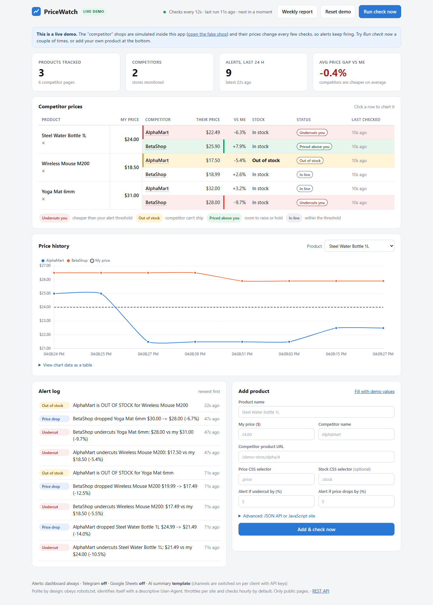
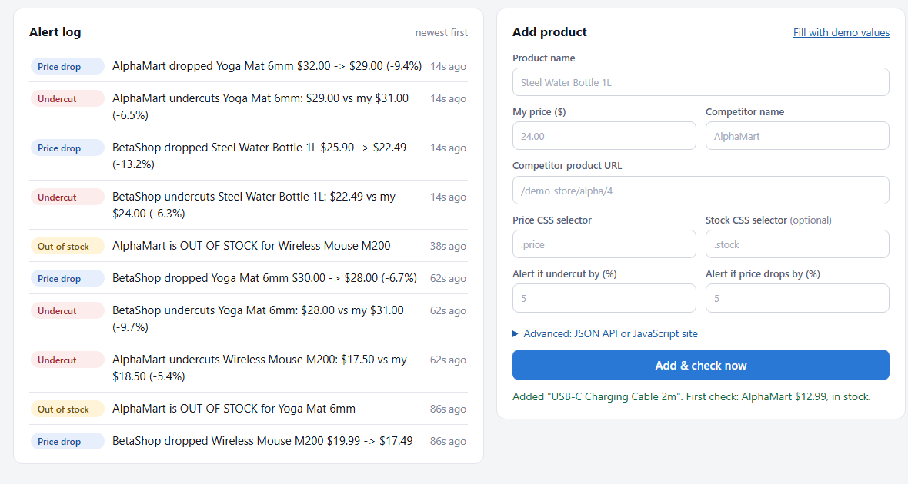
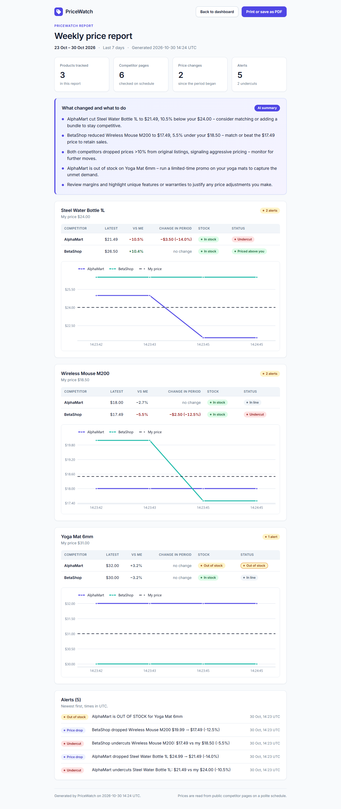

# PriceWatch - competitor price & stock monitor with alerts

**Live demo:** <https://pricewatch-x0x8.onrender.com> *(free Render instance: it sleeps after about 15 minutes idle, so the first load can take about a minute)*

Small online sellers lose sales when a rival quietly undercuts them or runs out of stock, and checking
competitor pages by hand is slow and easy to forget. **PriceWatch** checks those pages on a schedule, keeps the
price history, alerts you the moment something changes, and gives you a dashboard and a weekly report.

> Rule of thumb: for a seller tracking 30-50 products this replaces roughly 5-10 hours a week of manual checking,
> and undercuts are noticed within the hour instead of days later.



## What it does

- **Tracks** your products against any number of competitor pages (HTML pages via CSS selector, JSON APIs via JSON path).
- **Stores history** of every check in SQLite.
- **Alerts** on three rules (below) via the dashboard, **Telegram** and **Google Sheets**.
- **Dashboard** with summary cards (products, competitors, undercuts now, alerts in 24 h, last check), a price table
  with status pills, signed % difference, stock pills and relative "last checked" times, a per-product price-history
  chart that opens from any row, an alert log, and an **Add product** form with field hints and inline validation that
  runs a real first check before saving. A friendly empty state covers the first seconds after a restart, and the layout
  works down to phone width.
- **Weekly HTML report** with a title block and date range, one card per product with its chart and a competitor table, and a
  highlighted 5-line summary labelled **AI summary** (your Groq or Gemini key) or **Template summary** (no key). It is
  print-ready, so a client can save it as PDF from the browser.
- **JavaScript-heavy shops:** optional Playwright backend, or an optional **AI browser agent** backend
  (`browser-use` + Groq or Gemini) per product.
- **Polite by design:** `robots.txt` check, descriptive User-Agent, per-site delay, hourly default.

| Add a product and check it instantly | Weekly report |
|---|---|
|  |  |

## How it works

```
products.yaml  ->  scheduler (every N s / hourly)  ->  backend per competitor page
(products, URLs,      or "Run check now" button        http: httpx + BeautifulSoup   (default)
 selectors,                                            playwright: JS-rendered pages (optional)
 thresholds)                                           browser_agent: browser-use + Groq/Gemini (optional)
                                  |
                                  v
                  SQLite history (checks, alerts, errors)  ->  alert rules
                                  |                              |
                     dashboard (FastAPI + Jinja2 +         Telegram / Google Sheets / dashboard log
                     Chart.js) + weekly report.py
```

| File | Role |
|---|---|
| `app.py` | FastAPI app: dashboard, JSON API, scheduler lifecycle, optional embedded demo store |
| `core.py` | config, SQLite, scraping backends, alert rules, notifiers |
| `polite.py` | `robots.txt` helper, per-host throttle, SSRF guard for user-supplied URLs |
| `scheduler.py` | background thread: every N seconds (60 in demo, 3600 otherwise) |
| `llm.py` | AI provider layer: Groq (default, plain `httpx`) or Gemini; retries, then falls back to the template |
| `browser_agent.py` | optional AI browser backend (`browser-use` + Groq or Gemini) |
| `report.py` | weekly report (matplotlib charts + summary) |
| `monitor.py` | CLI for cron: `--once` / `--every SECONDS` |
| `demo_store/` | fake competitor shops whose prices keep changing |
| `verify.py` | in-process end-to-end test, no servers or keys needed (AI calls go to a built-in mock) |
| `smoke_groq.py` | one real Groq call with your key: prints provider, model and the generated summary |

## Alert rules

Thresholds live in `products.yaml` (`undercut_pct`, `drop_pct`, globally or per product, and in the form).

| Alert | Fires when |
|---|---|
| **Undercut** | a competitor's price goes below `my_price` by more than `undercut_pct` |
| **Price drop** | a competitor's price falls by more than `drop_pct` since its previous check |
| **Out of stock** | a competitor's page flips from in stock to out of stock |

Alerts fire when a condition **starts**, not on every check, so you get one message, not one per hour.
Each alert goes to the dashboard log; Telegram and Google Sheets are added when their keys are set
(`.env.example`). A failed or blocked check never crashes the run; it shows up in the table as "Check failed" with the reason.

## Run it

Needs Python 3.12. No API keys required (the AI features are optional, see [AI provider](#ai-provider-groq-default-gemini-optional)).

```powershell
# Windows PowerShell
py -3.12 -m venv .venv
.venv\Scripts\pip install -r requirements.txt
$env:DEMO_MODE = "1"
.venv\Scripts\uvicorn app:app --port 8000        # open http://127.0.0.1:8000
```

```bash
# macOS / Linux
python3.12 -m venv .venv && .venv/bin/pip install -r requirements.txt
DEMO_MODE=1 .venv/bin/uvicorn app:app --port 8000
```

`DEMO_MODE=1` is a single process: the dashboard, a fake competitor shop at `/demo-store/`, and a scheduler that
checks every 60 s (`CHECK_INTERVAL_SECONDS`). Three warm-up checks run at start, so alerts show up within a few
seconds and keep firing as the fake prices cycle.

**Use it for real:** set `DEMO_MODE=0`, put real URLs in `products.yaml` (or use the form), set
`DASHBOARD_PASSWORD`. The scheduler then checks hourly (`CHECK_INTERVAL_SECONDS=3600`).
Prefer cron? Set `SCHEDULER=0` and run `python monitor.py --once` (hourly) and `python report.py` (weekly):

```
0 * * * *  cd /path/pricewatch && .venv/bin/python monitor.py --once
0 8 * * 1  cd /path/pricewatch && .venv/bin/python report.py
```

(The demo store keeps its price counters in memory, so for demo prices to move use the web app or `python monitor.py --every 10`,
not repeated `--once` calls.)

Windows Task Scheduler: `schtasks /Create /SC HOURLY /TN PriceWatch /TR "C:\path\.venv\Scripts\python.exe C:\path\monitor.py --once"`
(set "Start in" to the project folder).

**Test everything without servers or keys:** `python verify.py` (unit checks, three pipeline runs against the demo store,
dashboard render, API and form flow, report generation).

### Adding competitors in `products.yaml`

```yaml
- name: Steel Water Bottle 1L
  my_price: 24.00
  undercut_pct: 4                     # optional per-product override
  competitors:
    - {store: ShopX, url: "https://www.shopx.com/p/123", css_selector: ".price", stock_selector: ".availability"}
    - {store: ShopY, url: "https://shopy.com/api/products/9", json_path: "product.price", stock_path: "product.available"}
    - {store: JsShop, url: "https://example.com/p", css_selector: ".price", backend: playwright}
    - {store: HardShop, url: "https://example.com/p2", backend: browser_agent}
```

### Optional backends for JavaScript-heavy sites

Default is `http` (fast, cheap, most shops). Install extras only if you need them:

```
pip install -r requirements-browser.txt
playwright install chromium          # for backend: playwright
# browser_agent also needs GROQ_API_KEY (or GEMINI_API_KEY) in .env, plus Chrome / Edge / Chromium on the machine
```

`browser_agent` opens the page in a real browser with the `browser-use` library, asks the configured model
(Groq `openai/gpt-oss-120b` by default, or Gemini `gemini-3.1-flash-lite`) to read the current price
and availability, and is restricted to the competitor's own domain.
On **Groq the agent is text/DOM-only** (`use_vision=False`): Groq currently has no vision-capable model, so it reads the page
structure, not screenshots. Pages that show the price only inside an image or canvas need the **Gemini** provider
(`LLM_PROVIDER=gemini`), which keeps screenshot understanding on.
It is slower and costs a few model calls per check, so use it only where selectors cannot work.
Without the package or an AI key those competitors are **skipped with a clear message**, never a crash.

## AI provider (Groq default, Gemini optional)

AI is used in two optional places: the **weekly report summary** and the **`browser_agent` backend**. Everything else
(scraping, alerts, dashboard) works without it. **Groq** is the default provider (free tier, OpenAI-compatible API,
called with plain `httpx`, no SDK). **Gemini** still works if you prefer it. With no key, the report uses a built-in template.

| Variable | Default | Meaning |
|---|---|---|
| `LLM_PROVIDER` | auto | `groq`, `gemini` or `none`. Blank = `groq` if `GROQ_API_KEY` is set, else `gemini` if `GEMINI_API_KEY` is set, else `none` |
| `GROQ_API_KEY` | - | key from <https://console.groq.com> |
| `GROQ_MODEL` | `openai/gpt-oss-120b` | model for the report summary (`openai/gpt-oss-20b` is a faster, cheaper alternative) |
| `GROQ_FALLBACK_MODEL` | `openai/gpt-oss-20b` | used automatically when the primary model's daily cap is hit (HTTP 429 "tokens per day"); empty = off. `report.summary_with_source()` returns the model that answered |
| `GROQ_BROWSER_MODEL` | `openai/gpt-oss-120b` | model for `browser_agent`; needs structured output. Text/DOM-only on Groq (no vision model there) |
| `GROQ_BASE_URL` | `https://api.groq.com/openai/v1` | override only for a proxy or a test mock |
| `GEMINI_API_KEY` / `GEMINI_MODEL` | - / `gemini-3.1-flash-lite` | optional Gemini provider |

- A rate limit (429), a server error (5xx) or a network timeout is retried up to 3 times with backoff; if it still fails, the
  report uses the templated summary. A failed AI call never breaks a report or a check.
- `gpt-oss` models are reasoning models: they spend roughly 200 tokens thinking before the visible answer, so the app
  requests `max_tokens` of 1024 or more. Keep that in mind if you add your own prompts through `llm.generate()`.
- Groq's model list changes. Confirm the ids you use exist with `GET https://api.groq.com/openai/v1/models`
  (header `Authorization: Bearer $GROQ_API_KEY`), or run `python smoke_groq.py --models`, and override `GROQ_MODEL` /
  `GROQ_BROWSER_MODEL` in `.env` if one has been retired.
- `python smoke_groq.py` makes one real call with your key and prints the provider, model and generated summary.
  `python verify.py` never calls a real API; it runs the same code against a mock endpoint (success, 429-then-success,
  persistent 500, a daily-cap 429 answered by the fallback model, `none` mode).
- API keys are read from the environment only and are never written to logs, the database or the dashboard.

## Deploy

`Dockerfile` (python:3.12-slim) runs on `$PORT`, defaults to **7860**, and starts in demo mode, so a public demo is one
container. The free live demo is hosted on **Render** (Docker runtime, free instance; `render.yaml` is a one-file blueprint).
Step-by-step in **[DEPLOY.md](DEPLOY.md)**, including a real-client setup with a persistent volume and password. Hugging Face
Spaces now needs a PRO subscription, so it is no longer the free path. SQLite is ephemeral on free hosts; for the demo that
is fine, because warm-up checks refill the dashboard on every start.

## Polite scraping and legal note

- Only monitor **public** product pages. Do not log in, bypass captchas, or defeat bot protection.
- `robots.txt` is checked before the first fetch of each host (cached 24 h). Disallowed pages are skipped and shown as "Check failed: blocked by robots.txt".
  Disable only for sites you own: `respect_robots: false`.
- A descriptive `User-Agent` with a contact address (`settings.user_agent` in `products.yaml`, shipped as
  `PriceWatch/1.0 (+https://github.com/shivam911898/pricewatch; contact: sak23571113@gmail.com)`; client deployments put the client's own), at least `delay_seconds` between requests to the same host,
  and hourly-or-slower scheduling (the app logs a warning if you configure faster for real sites).
- Check each site's terms of service before adding it. Price information that is publicly shown is commonly monitored,
  but rules differ by country and site; this is not legal advice, and the person running the bot is responsible for how it is used.
- The "Add product" form refuses private/local addresses (SSRF guard); the public demo accepts only its built-in demo store.
- Security: optional HTTP Basic login (`DASHBOARD_PASSWORD`), custom-header CSRF guard on every write call, Jinja2 auto-escaping, parameterised SQL, no secrets in the repo.

## Limits

- CSS selectors break when a site redesigns; update the selector (or use the AI browser backend).
- Large marketplaces and sites behind aggressive bot protection (Amazon, Cloudflare challenges) are out of scope for this approach.
- The price is the first number found in the selected element; "was $30 / now $24" blocks need a tighter selector. One currency per instance (`settings.currency`).
- SQLite, single process, single-user dashboard: fine for hundreds of products, not a multi-tenant SaaS.
- The demo competitors are simulated; the AI browser backend is not part of the default image.
- Free hosts sleep when idle and lose their disk on restart.

## Third-party

[Chart.js](https://www.chartjs.org/) 4.4.7 (MIT) is vendored in `static/` so the page works without a CDN. The UI uses the Inter font from Google Fonts when online and falls back to the
system font offline. Everything else is installed from `requirements.txt`.

## License

MIT, see [LICENSE](LICENSE).

---

Built by Shivam Kumar Yadav · sak23571113@gmail.com · github.com/shivam911898
